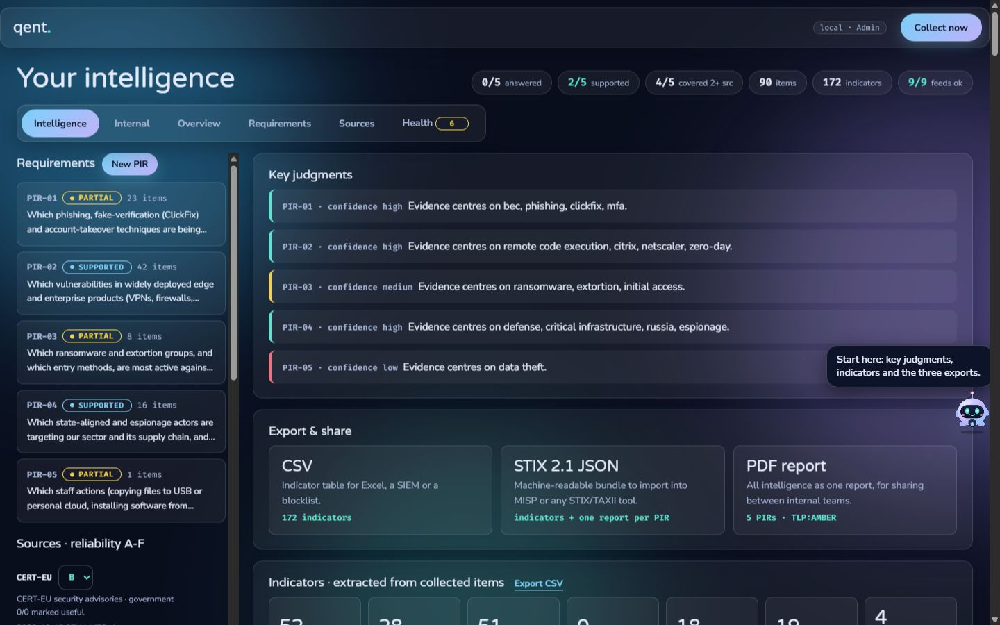
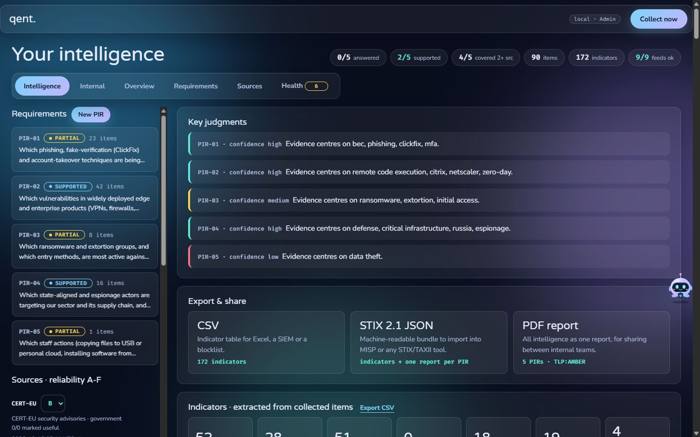
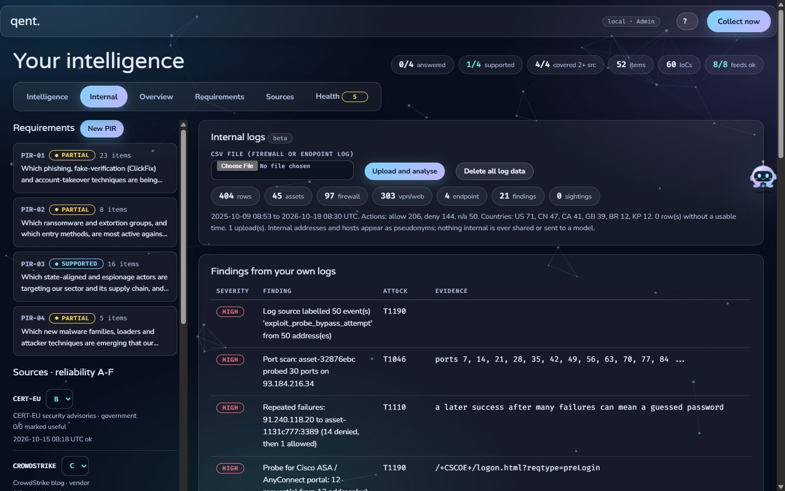
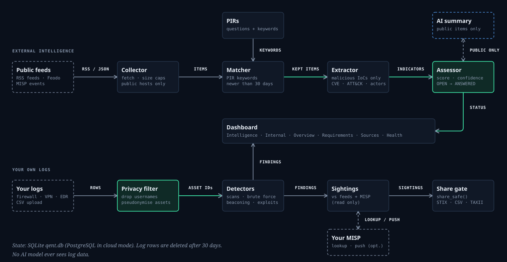
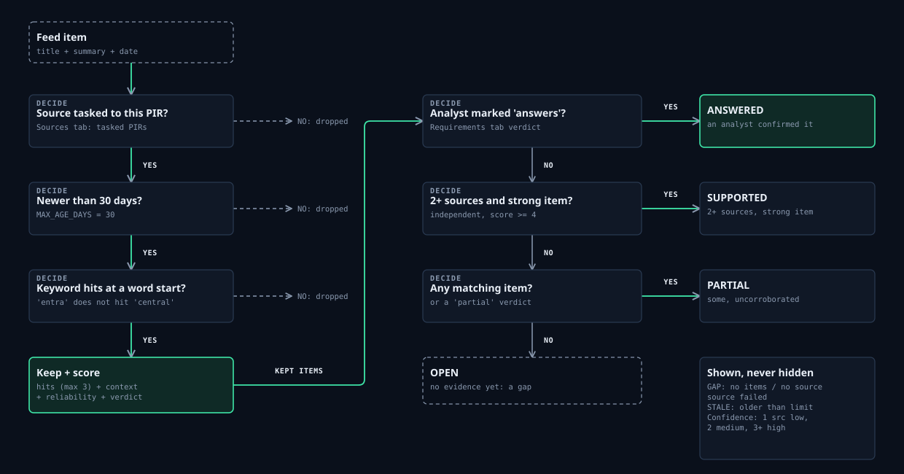
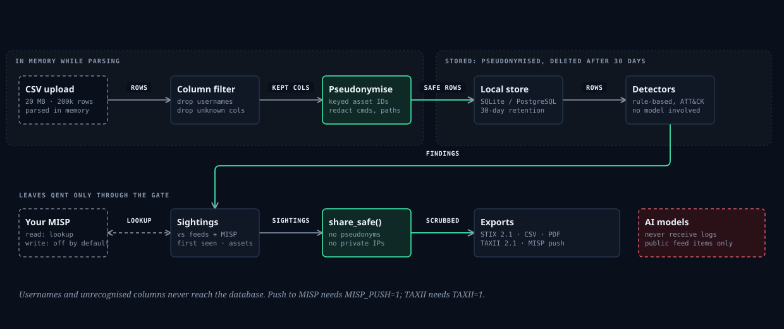
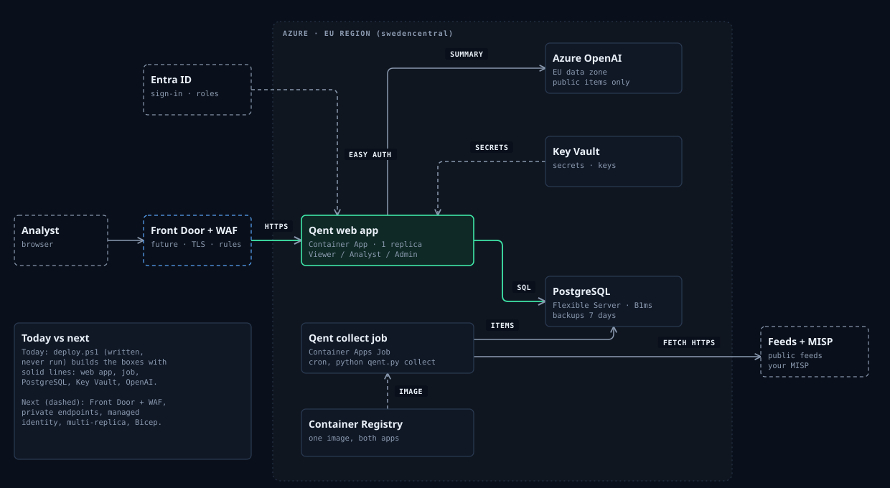

<div align="center">

# Qent

**Threat intelligence that starts from your questions.**
Priority intelligence requirements (PIRs) in, evidence-backed answers out: external feeds, your own MISP, and your own firewall / VPN / endpoint logs in one dashboard.


</div>

*Qent* answers one question: **which of the hundreds of threat reports a week actually answer what our business needs to know, and are we sure?** It starts from written PIRs, keeps only feed items that match them, extracts indicators, and tells you per PIR what is known and how well it is corroborated.

**[Live page →](https://idiljot-singh.github.io/Qent/)** · **[Walkthrough](WALKTHROUGH.md)** · **[Intro film](docs/qent-intro.mp4)**



| Intelligence | Internal logs |
|---|---|
|  |  |

<sub>Screenshots use the bundled demo PIRs and the synthetic logs in `samples/`. No real data.</sub>

## Diagrams

**How Qent works**



**From feed item to PIR status**



**Internal log privacy and sharing**



**Future cloud production (Azure, EU)**



All four on one page: [docs/diagrams.html](https://idiljot-singh.github.io/Qent/diagrams.html).

## Try it in 2 minutes

```
python qent.py            # http://localhost:8080 , data in qent.db
python qent.py --test     # self-test, no network, prints "selftest ok"
```
Python 3.12+, **no packages needed** (only `pip install openpyxl` for the first-start PIR import). The first start loads the **demo PIRs** from `pir_workbook.xlsx`.

Demo path for a presentation:
1. Click **Collect now**. Nine public feeds (CISA KEV, CERT-EU, Microsoft, CrowdStrike, Unit 42, The DFIR Report, The Hacker News, Dark Reading, abuse.ch) are read; only items matching a PIR are kept, with CVEs, IPs, hashes and actors extracted.
2. **Requirements** tab: each PIR moves from OPEN to PARTIAL to SUPPORTED (2+ independent sources and a strong item). An analyst confirms ANSWERED.
3. **Internal** tab: drop `samples/ssl_vpn_logs.csv`, then `firewall.csv` and `edr.csv`. About 20 findings appear with no feed and no AI: scans, brute force, success after failures, beaconing, encoded PowerShell, certutil abuse, Fortinet / Citrix / Ivanti / Cisco exploit probes, scanner clients, impossible travel.
4. **Share**: STIX 2.1, CSV, PDF report, TAXII 2.1, MISP push, all scrubbed of internal identifiers.

## Demo PIRs (general, for any organisation)

| ID | Question | Level |
|---|---|---|
| PIR-01 | Which phishing, ClickFix and account-takeover techniques are being used against cloud and email accounts right now, and which controls stop them? | tactical |
| PIR-02 | Which vulnerabilities in widely deployed edge and enterprise products (VPNs, firewalls, gateways, load balancers, mail servers, operating systems) are exploited now, and which need patching within a day? | tactical |
| PIR-03 | Which ransomware and extortion groups, and which entry methods, are most active against organisations like ours, and what do they reach first? | strategic |
| PIR-04 | Which state-aligned and espionage actors target our sector and its supply chain, and through which suppliers or partners? | strategic |
| PIR-05 | Which new malware families, loaders and attacker techniques are emerging that our detections and hardening should cover? | tactical |

Each PIR carries 20+ keywords so collection is broad. Replace them with your own in the **Requirements** tab (New PIR, with keyword suggestions), or edit `pir_workbook.xlsx` before the first start.

## Features

| | |
|---|---|
| **PIR-first** | Every item is traced to a PIR and a graded source (reliability A to F). Nothing is shown "because it is new" |
| **Honest status** | OPEN / PARTIAL / SUPPORTED / ANSWERED, with a Health tab that flags failing feeds, matching and AI |
| **Sources** | RSS, CISA KEV, Feodo, MISP. Add your own in the Sources tab |
| **Internal logs (beta)** | CSV upload, privacy-first: usernames dropped, internal assets pseudonymised, commands redacted, 30-day retention |
| **Deterministic detections** | Rule-based, mapped to MITRE ATT&CK, no model involved |
| **MISP** | Look up your log indicators in your MISP (read), optionally push events and sightings back (off by default) |
| **Outputs** | STIX 2.1, CSV, PDF, read-only TAXII 2.1 |
| **AI summaries** | Optional (Gemini for dev, Azure OpenAI EU for cloud), public feed items only |
| **Small** | One file, standard library only, SQLite (PostgreSQL in cloud mode) |

## Settings

Put them in a `.env` next to `qent.py` (git-ignored) or real environment variables. All optional.

| Variable | What for |
|---|---|
| `MISP_API_KEY` | key of your MISP (any name containing `MISP` works; type that name in the source) |
| `ALLOW_PRIVATE_HOSTS=localhost` | lets Qent talk to a MISP on a private address (https only) |
| `EXTRA_CA_FILE=path/to/cert.pem` | trust a self-signed MISP certificate in addition to the normal CAs |
| `INTERNAL_DOMAINS=corp.example.com` | your own DNS zones: names in them are never treated as public |
| `ORG_CONTEXT` / `ORG_PROFILE` | comma-separated terms that make an item more relevant to your estate (default: Microsoft 365, VPN, edge device, supply chain, ...) / one generic sentence about your organisation for the AI summary |
| `LOG_PSEUDO_KEY` | cloud: secret for internal-address pseudonyms (local mode generates its own) |
| `LOG_RETENTION_DAYS` | log rows are deleted after this many days (default 30) |
| `TAXII=1` | serve read-only TAXII 2.1 at `/taxii2/` |
| `MISP_PUSH=1` | allow writing events / sightings back to MISP |
| `GEMINI_API_KEY` / `AZURE_OPENAI_*` | AI summaries of public feed items only; logs never reach a model |

## Log columns

Recognised: `src_ip, dst_ip, dst_port, action/auth_result, hostname, process, command_line, sha256, url, domain, event_type, url_path, user_agent, src_country, time`. Anything else is dropped on upload.

## Cloud (not deployed)

`cloud/` has a Dockerfile and `deploy.ps1` (Azure, EU: Container Apps, PostgreSQL, Azure OpenAI). They are readable starting points, not tested end to end. Build from the repo root: `docker build -f cloud/Dockerfile .`

## Limits

A proof of concept. Log detections are heuristics (regular intervals are also normal for monitoring), log upload is capped at 20 MB / 200k rows, and the MISP push is untested against production. See [SECURITY.md](SECURITY.md).

## License

MIT, see [LICENSE](LICENSE).
